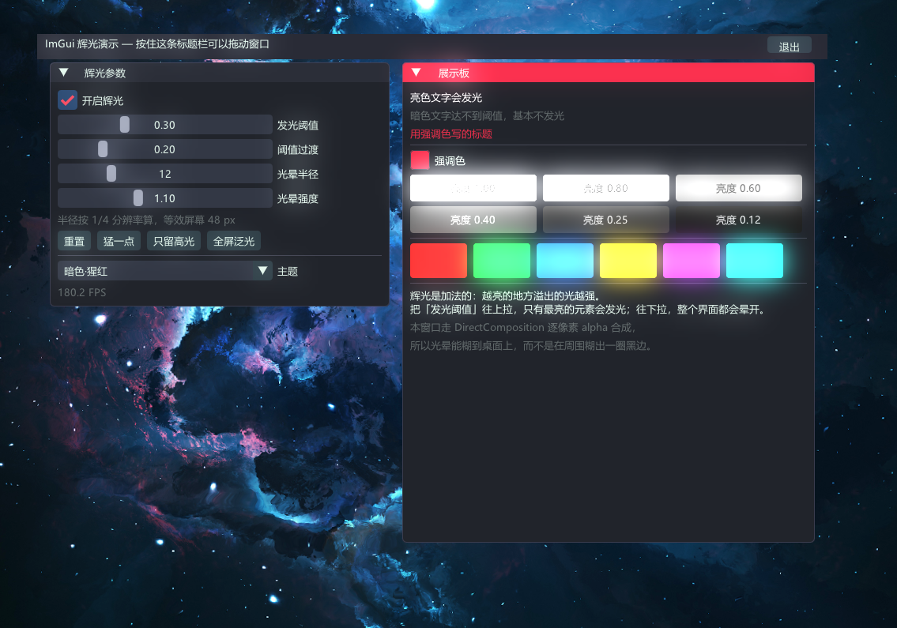
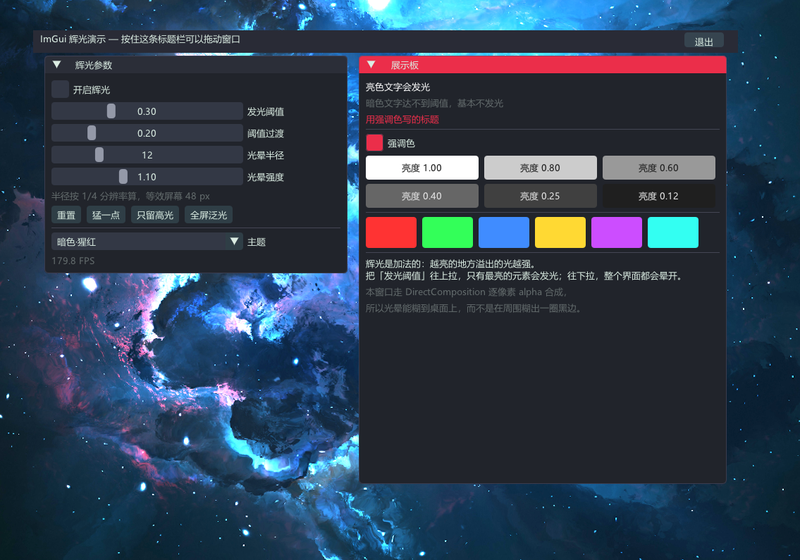

<div align="center">

# ImGui 辉光特效

**Dear ImGui + DirectX 11 的真·泛光（bloom）后处理 —— 单头文件，拖进项目就能用。**

亮色元素会向外溢出柔和的光晕，真的糊到背后的游戏画面 / 桌面上，而不是「描几层边假装发光」。

[](LICENSE)
[]()
[]()
[]()
[](https://github.com/ocornut/imgui)
[]()



</div>

---

## 效果对比

左边是关掉辉光，右边是开启。注意左边色块边缘是硬的，右边每个色块都在往外溢光、
相邻颜色互相晕染，面板边缘的光甚至糊到了壁纸上。

<table>
<tr>
<td width="50%"></td>
<td width="50%"></td>
</tr>
<tr>
<td align="center"><b>关闭辉光</b></td>
<td align="center"><b>开启辉光</b></td>
</tr>
</table>

---

## 这是什么

一个给 Dear ImGui 用的泛光后处理，输出到 Direct3D 11。和网上流传的几种「ImGui 辉光」方案的区别：

| 方案 | 做法 | 光会不会外溢 |
|---|---|---|
| **本项目** | 亮部提取 → 降采样 → 分离高斯 → 加法合成 | ✅ 会，平滑糊到背景上 |
| ~分层描边~ | 同一个形状按「加粗 + 降 alpha」画 N 层 | ❌ 只在自己轮廓周围，不外溢 |
| ~ImGui shadow 分支~ | `AddShadowRect` 等 API | ⚠️ 需要非上游的 ImGui 分支（**1.92 起主线已移除这套 API**） |

**特点**

- **单头文件**，除 `imgui.h` 和 `d3dcompiler` 外零依赖，直接拷进项目即可
- **1/4 分辨率做模糊**：代价只有全分辨率的 1/16，等效半径却是 4 倍（详见下方原理）
- **HLSL 运行期编译**，不需要预编译着色器，改参数不用重新构建
- **完整的状态保存/还原**，插进别人已有的渲染管线不会污染状态
- 参数全部可运行时调整，配合滑块现场调效果
- 实测 5120×1440 覆盖层下 **11.7% 单核占用**、锁定屏幕刷新率

---

## 快速开始

### 1. 拷文件

把 [`ImGuiGlowEffect.hpp`](ImGuiGlowEffect.hpp) 放进你的项目（它是自包含的）。

### 2. 初始化

必须在 `ImGui_ImplDX11_Init()` **之后**：

```cpp
#include "ImGuiGlowEffect.hpp"

static ImGuiGlowNS::GlowEffect g_glow;
static ImGuiGlowNS::GlowParams g_glowP;

// 初始化
if (!g_glow.Initialize(g_dev, g_ctx))
    printf("辉光初始化失败: %s\n", g_glow.LastError());
```

### 3. 每帧调用

位置必须是 **`ImGui::Render()` 之后、`Present()` 之前**：

```cpp
ImGui::Render();
const float clear[4] = { 0, 0, 0, 0 };   // alpha=0 才是真透明
g_ctx->OMSetRenderTargets(1, &g_rtv, NULL);
g_ctx->ClearRenderTargetView(g_rtv, clear);

bool glowDone = false;
if (g_glowP.enabled && g_glow.IsInitialized() &&
    g_glow.EnsureSize(w, h) && g_glow.BeginUIPass()) {
    ImGui_ImplDX11_RenderDrawData(ImGui::GetDrawData());
    g_glow.EndUIPass();                 // 必须先解绑，下一趟要读它当 SRV
    if (g_glow.Process(g_glowP)) {
        g_glow.Composite(g_rtv, g_glowP);
        glowDone = true;
    }
}
if (!glowDone) {
    // 兜底：没开辉光 / 半径 0 / 尺寸还是 0 / 初始化失败 —— 直接画，
    // 界面不会因为辉光出问题而整个消失
    g_ctx->OMSetRenderTargets(1, &g_rtv, NULL);
    ImGui_ImplDX11_RenderDrawData(ImGui::GetDrawData());
}
```

> `EndUIPass()` 不能省。`ImGui_ImplDX11_RenderDrawData` 会把它进来时的 RTV 还原回去，
> 所以画完仍然绑着离屏 RT，不解绑下一趟没法把它当 SRV 采样。

---

## ⚠️ 前提：窗口必须走逐像素 alpha 合成

**这条不满足就别接了。** 而且它不是「更好的做法」，是**能不能用**的问题。

如果窗口用**彩色键**透明：

```cpp
SetLayeredWindowAttributes(hwnd, RGB(0,0,0), 0, LWA_COLORKEY);   // ← 这样不行
```

彩色键的规则是「纯黑才透明，其余像素一律**替换**目标」。加法辉光从亮到暗是连续衰减的，
衰减到 5/255 之前那一大片都是「接近黑但不等于黑」，会全部变成不透明深灰，
把背后的画面**整片盖住** —— 开了辉光就是一大块黑斑。**调阈值只能把黑圈缩小，消除不了。**

可用的两种（本项目的演示用的是第一种）：

```cpp
// 方案 A：DirectComposition（推荐，见 example/glow_demo.cpp）
HWND h = CreateWindowExW(WS_EX_TOPMOST | WS_EX_NOREDIRECTIONBITMAP, ...);   // 注意：与 WS_EX_LAYERED 互斥
// 交换链必须用 CreateSwapChainForComposition 创建，且
//   DXGI_SWAP_EFFECT_FLIP_SEQUENTIAL + DXGI_ALPHA_MODE_PREMULTIPLIED

// 方案 B：分层窗口 + DWM 模糊behind
HWND h = CreateWindowExW(WS_EX_TOPMOST | WS_EX_LAYERED | ...);
DWM_BLURBEHIND bb = {};
bb.dwFlags  = DWM_BB_ENABLE | DWM_BB_BLURREGION;
bb.fEnable  = TRUE;
bb.hRgnBlur = CreateRectRgn(0, 0, -1, -1);
DwmEnableBlurBehindWindow(h, &bb);
```

**为什么这样就成立**：DWM 合成预乘 alpha 窗口的公式是

```
out = src.rgb + dst.rgb * (1 - src.a)
```

合成着色器输出的 alpha **只取自 UI**，辉光那部分 `src.a` 恒为 0。于是辉光像素上公式退化成

```
out = 背景 + 辉光          ← 纯加法
```

光晕外圈淡出时既不遮住背景，也不留黑边；空白处 rgb 和 a 都是 0，完全透明。

---

## 原理

```
ImGui 画进离屏 RT
      ↓
亮部提取（低于阈值的丢掉）+ 4× 降采样
      ↓
两趟分离高斯（横向一趟、纵向一趟）
      ↓
合成回后台缓冲： ui.rgb + glow * intensity ，alpha 只取 UI 的
```

**为什么降到 1/4 分辨率**：高斯模糊的代价正比于像素数。1/4 分辨率下半径 12 的模糊，
等效于全分辨率半径 48，但成本只有 1/16。上采样时的双线性插值顺手把光晕抹得更顺 ——
辉光本来就是糊的，完全不需要全分辨率。

**为什么用分离高斯**：二维高斯可以拆成横、纵两趟一维卷积，采样数从 `N²` 降到 `2N`。
一个着色器靠方向参数跑两趟就够了。

---

## API

```cpp
namespace ImGuiGlowNS {

struct GlowParams {
    bool  enabled   = true;
    float threshold = 0.30f;   // 亮部阈值，0~1（直通色）
    float knee      = 0.20f;   // 阈值软过渡宽度
    float radius    = 12.0f;   // 1/4 分辨率下的高斯半径，等效屏幕半径 = 4×
    float intensity = 1.10f;   // 辉光强度
};

class GlowEffect {
    bool Initialize(ID3D11Device*, ID3D11DeviceContext*);  // 在 ImGui_ImplDX11_Init 之后调
    bool IsInitialized() const;
    const char* LastError() const;                          // 编译失败时这里是完整错误

    bool EnsureSize(int w, int h);      // 尺寸变了会重建 RT；w/h 非法返回 false
    bool BeginUIPass();                 // 绑离屏 RT 并清成透明黑
    void EndUIPass();                   // 解绑，让纹理能被当 SRV 读
    bool Process(const GlowParams&);    // 亮部 -> 降采样 -> 模糊
    void Composite(ID3D11RenderTargetView* dst, const GlowParams&);   // 合成

    void Release();
};
}
```

**参数怎么调**：

| 想要的 | 动哪个 |
|---|---|
| 只有最亮的元素发光 | 把 `threshold` 往上拉 |
| 整个界面晕开 | 把 `threshold` 往下拉、`knee` 拉大 |
| 光晕范围更大 | 加大 `radius`（注意是 1/4 分辨率下的值，屏幕上要 ×4） |
| 光更亮但不更散 | 只加 `intensity` |
| 阈值边缘出现生硬断层 | 加大 `knee` |

---

## 跑演示

```bat
git clone https://github.com/Ker0el/imgui-glow-effect.git
cd imgui-glow-effect
git submodule update --init --recursive
:: 在已经 load 过 vcvars 的 cmd 里：
build_msvc.bat
```

或者用 CMake（会自己拉 ImGui）：

```bat
cmake -B build -G "Visual Studio 17 2022"
cmake --build build --config Release
```

演示是一个不依赖任何宿主程序的独立窗口，左侧四个滑块实时调参，右侧「展示板」放了
一排不同亮度的按钮和六块高饱和色块 —— 把「发光阈值」往上拉能直接看出谁先掉出去。
窗口无边框，**按住顶部标题栏可以拖动**，Esc 或标题栏的「退出」关闭。

> `build_msvc.bat` 的注释是英文的，这不是偷懒：cmd 按**字节偏移**解析 `.bat`，
> 中文注释会让偏移错位，遇到 `^` 续行或 `if (...)` 块就断在半个字符上，报一堆莫名其妙的错。
> 中文说明都放在 `.md` 和 `.hpp/.cpp` 里。

---

## 踩过的坑

开发过程中实际撞到的问题，换项目时会原样复现：

- **ImGui 1.92 起删掉了 `AddShadowRect` / `AddShadowCircle` / `AddShadowConvexPoly`**
  （重构纹理系统时移除）。网上传得最广的那套 ImGui 辉光教程（UnKnoWnCheaTs
  「Add Glow/Shadow ImGui」）依赖的是 **ImGui 的 shadow 分支，不是上游**，主线代码直接抄编译不过。
- **flip 模型交换链不能对后台缓冲建 SRV**（不支持 `DXGI_USAGE_SHADER_INPUT`）。
  所以「抓后台缓冲做背景模糊」那类管线**没法**和 DirectComposition 共存 —— 这也是
  「方案 A vs 方案 B」要按项目实际情况选的原因。
- **合成交换链的 `Present` 不受 vsync 节流**。DWM 按自己的节奏取帧，Present 立刻返回，
  不节流主循环会空转到几千 FPS、**实测烧掉 107% 单核**。用 `DwmFlush()` 压到屏幕刷新率
  （降到 11.7%）。`IDXGISwapChain2` 的帧延迟等待对象对 `CreateSwapChainForComposition`
  出来的交换链**不生效**，别在那上面浪费时间。
- **flip 模型的后台缓冲在 `Present` 之后会换一张**，必须每帧重新 `GetBuffer(0)` 建 RTV。
  缓存一个反复用的话，从第二帧起就是在往正在显示的那张上画。
- **无边框窗口拖动不能用 ImGui 的 `io.MouseDelta`**：窗口一移动客户区坐标就跟着变，
  delta 一帧大一帧小，拖起来会抖甚至往回跳。要用「光标屏幕坐标 − 窗口左上角」的固定偏移，
  完整实现见 `example/glow_demo.cpp` 的 `DrawTitleBar()`。
- **`.bat` 里的路径结尾不能带反斜杠再进引号**：`/I"D:\dir\"` 里的 `\"` 在 C 运行时的
  argv 解析里是**转义引号**，会把闭合引号吃掉、后面整条命令行并进同一个参数，
  表现为 `cl: D8003: 缺少源文件名`。

---

## 实测

| 项目 | 结果 |
|---|---|
| 背景压暗 | **0** —— 窗口边界内外像素完全相同 |
| 帧率 | 179.9 FPS（锁定屏幕 180Hz 刷新率） |
| CPU | 11.7% 单核 |
| 显存 | 全分辨率离屏 RT 1 张 + 1/4 分辨率辉光链 2 张，5120×1440 下约 33 MB |

---

## 兼容性

- Windows 8+（DirectComposition 要求；`DwmEnableBlurBehindWindow` 那条路 Win7 也行）
- Direct3D 11，着色器模型 5.0
- Dear ImGui 1.91 及以上（更老的版本没测，`ImDrawData` 接口没变的话应该也能用）
- MSVC / C++17。代码里用了 `#pragma comment(lib, "d3dcompiler.lib")`，MSVC 直接过；
  其它编译器去掉那行、自己链 `d3dcompiler` 即可

---

## 许可

[MIT](LICENSE)
